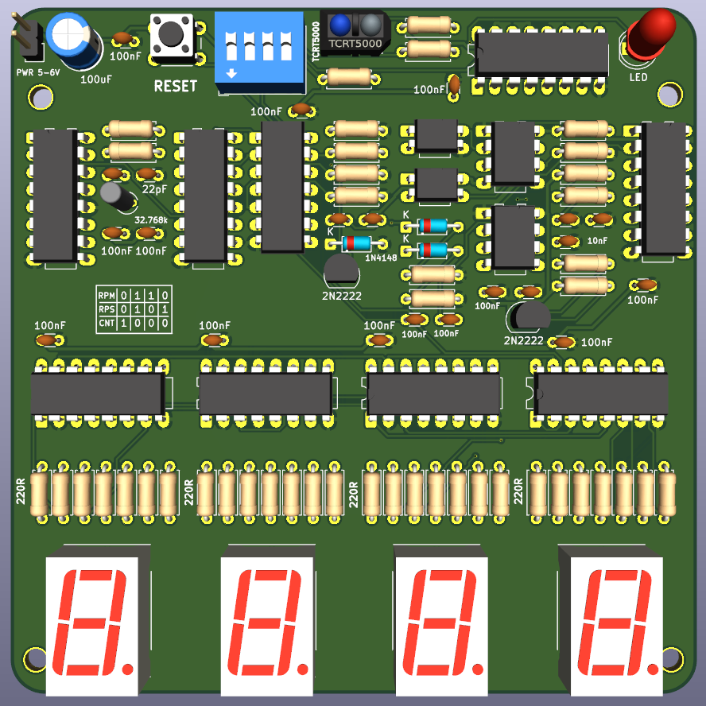
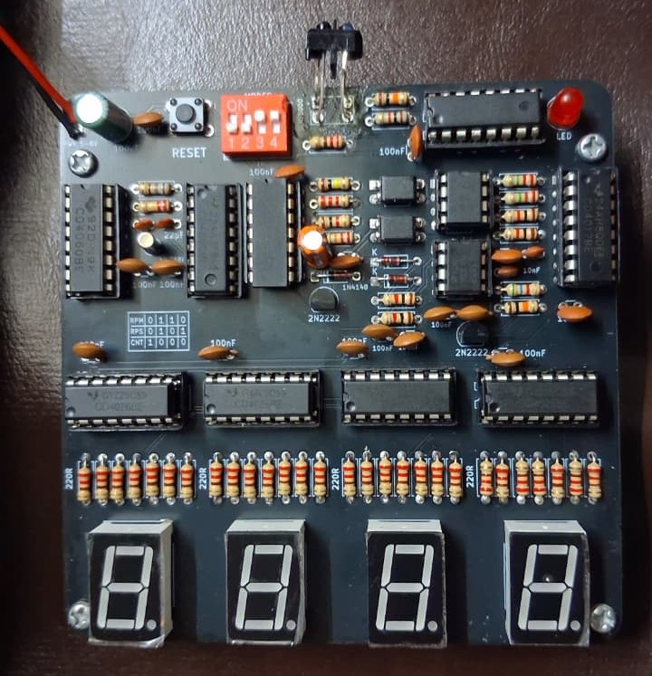
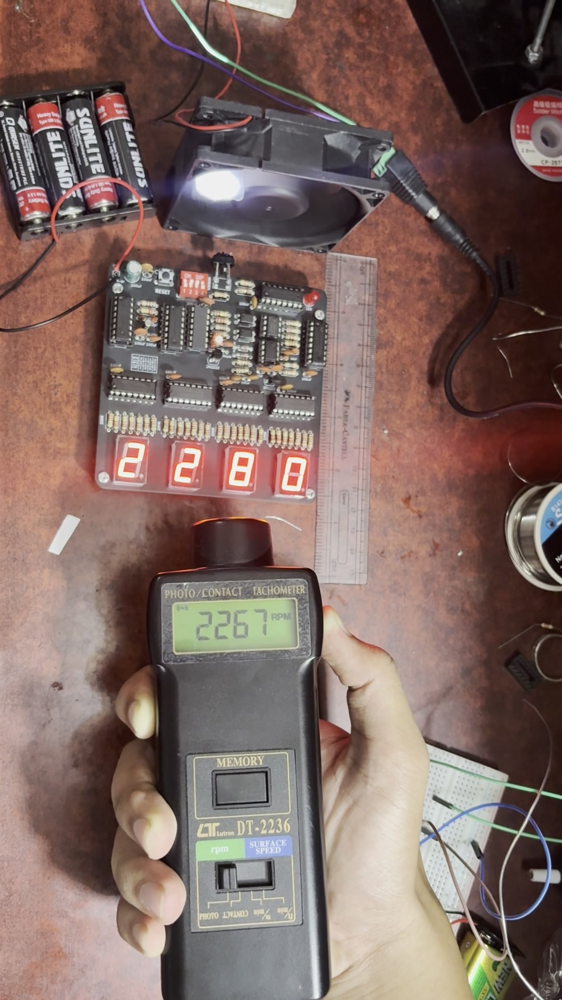
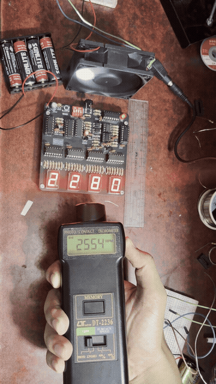
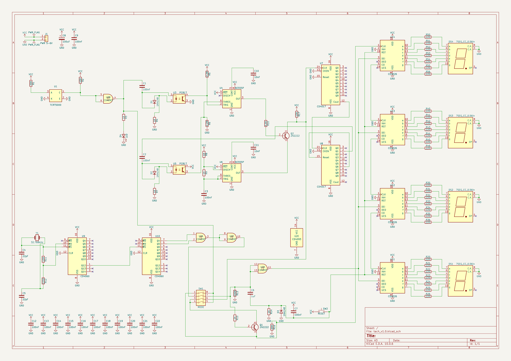
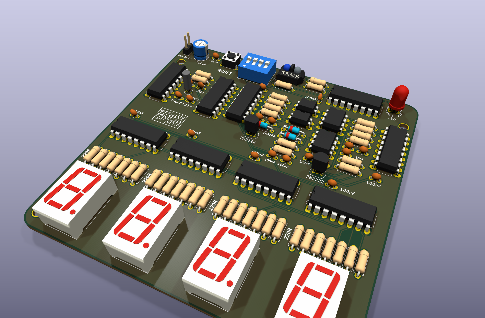
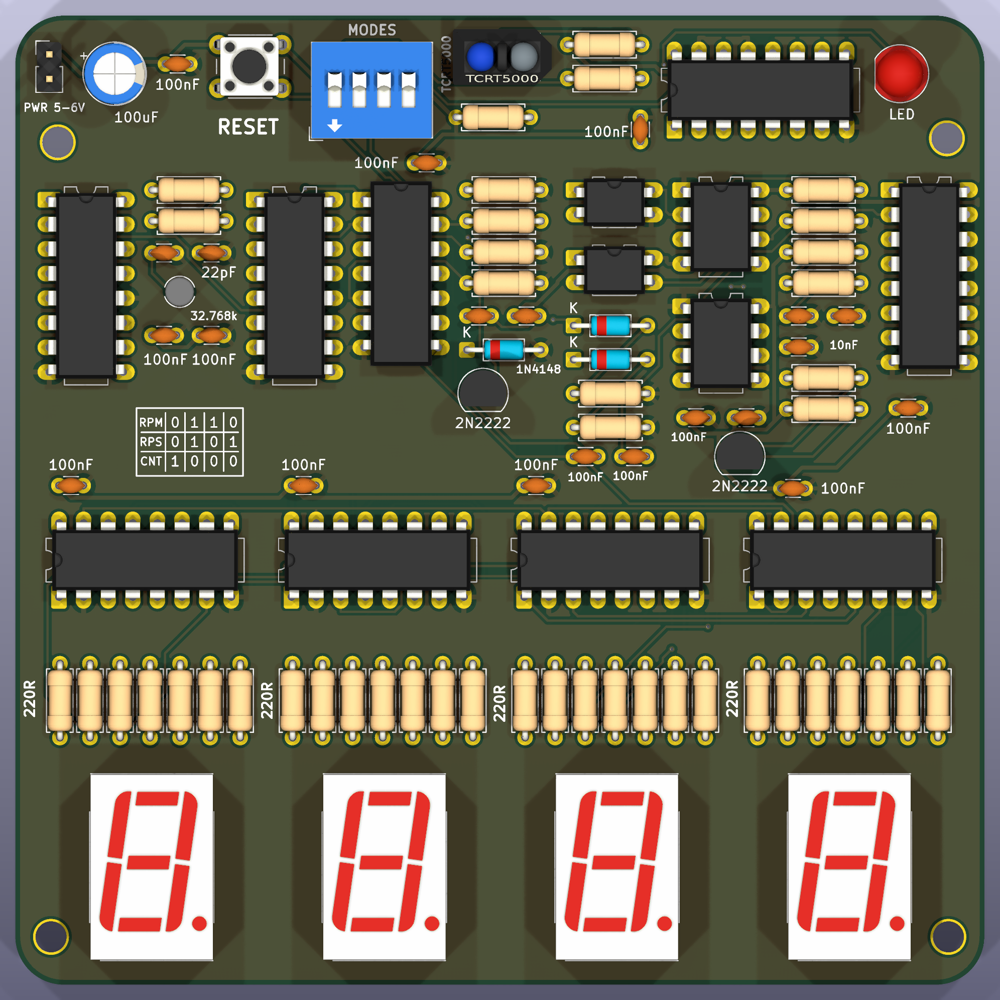
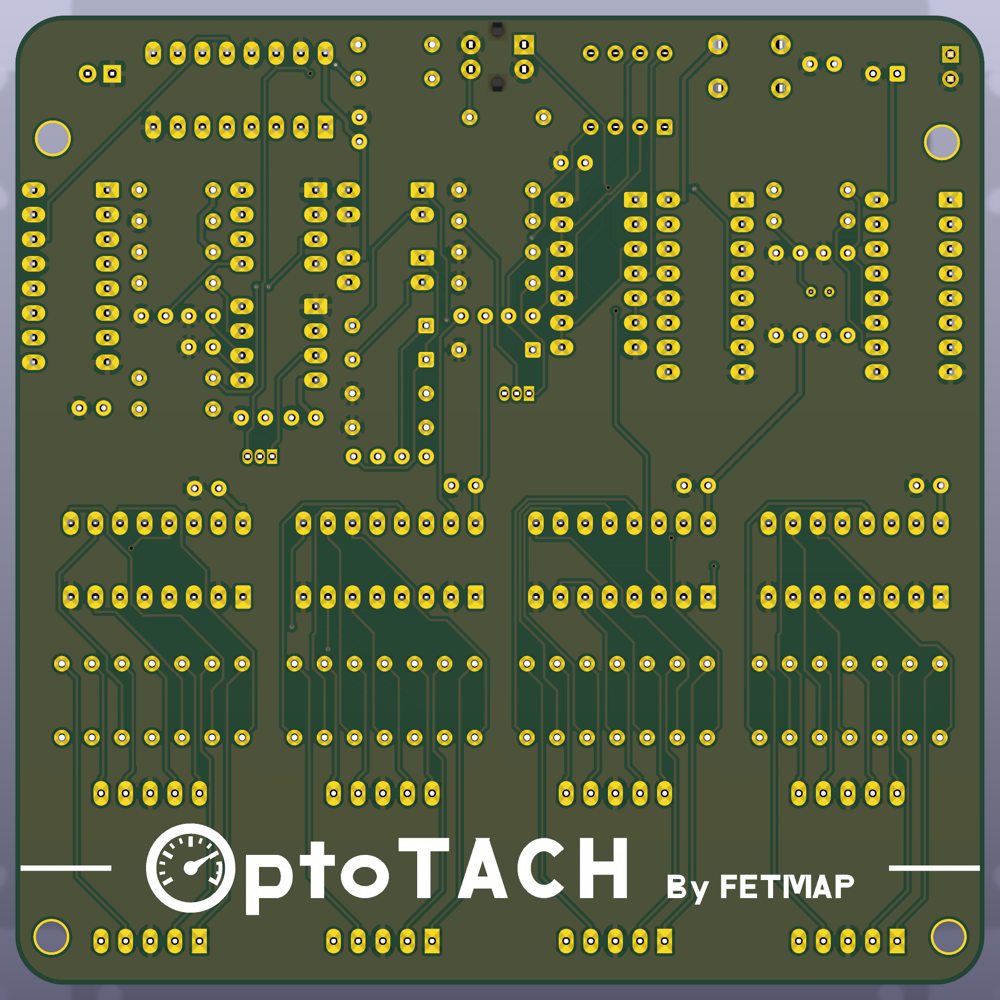

# OptoTACH
### A Precision Non-Contact Optical Tachometer Built Entirely Without a Microcontroller

[](#bench-validation--accuracy-analysis)
[](https://www.kicad.org/)
[](#system-architecture--circuit-redesign)
[](#pcb-layout--hardware-design)
[](LICENSE)

**OptoTACH** is a discrete hardware engineering project that implements a full-featured, 4-digit optical tachometer (0–9999 RPM / RPS / Event Counter) using **pure CMOS logic and analog timing circuits**—completely free of microcontrollers, firmware, and software dependencies.


## ⚡ Showcase & Physical Verification

| 3D CAD Visualization | Assembled Hardware Prototype | Live Calibration vs Commercial Bench Standard |
| :---: | :---: | :---: |
|  |  |  |
| *Raytraced 3D model in KiCad* | *Physical board with socketed DIP ICs* | *Benchmark vs Lutron DT-2236 (2267 vs 2280 RPM)* |

### 🎬 Live Bench Demo
The board measures the rotational velocity of a high-speed cooling fan equipped with a reflective marker. The reading automatically updates every 4 seconds with zero display jitter.

<p align="center">
  
  <br>
  <em>Live demonstration: OptoTACH benchmarked alongside an industrial Lutron DT-2236 photo/contact tachometer.</em>
  <br>
  <a href="media/optotach_demo.mp4">▶️ Download / View Full 1080p Demo Video (2 min 50 sec, 35 MB MP4)</a>
</p>


## 🔄 Inspiration & Circuit Redesign (Overcoming IC Obsolescence)

This project was inspired by the original design published by [Mousa Simple Projects (August 2020)](https://www.mousa-simple-project.com/2020/08/non-contact-tachometer-without.html). However, **the schematic in OptoTACH is fundamentally redesigned** due to component obsolescence and supply-chain constraints.

### The Problem: Obsolescence of the CD40110
The original 2020 design relied on 4 × **CD40110** integrated circuits. The CD40110 incorporates an up/down decade counter, 7-segment decoder, and an internal display latch into a single package. Because the CD40110 has been largely discontinued and is unobtainable in South Asian markets (including Bangladesh), building the circuit directly from the original schematic was impossible.

### The Solution: Re-engineering with the CD4026BE
OptoTACH replaces the obsolete chips with the widely available **CD4026BE** (decade counter with 7-segment decoder). However, **the CD4026 has no internal display latch**. Without a latch, displaying raw pulses as they accumulate during a 1-second counting window would result in an illegible rolling blur.

To solve this without adding extra counter or latch ICs, OptoTACH introduces a synchronized **digital gating & display blanking mechanism**:

| Feature / Subsystem | Original Mousa Circuit (2020) | OptoTACH v1.0 (Redesigned) | Why the Change Matters |
| :--- | :--- | :--- | :--- |
| **Counter ICs** | 4 × **CD40110** (Obsolete / Discontinued) | 4 × **CD4026BE** (Standard / Readily Available) | Overcomes supply-chain unavailability |
| **Display Storage** | Internal CD40110 Display Latch | **Digital Blanking Window (CD4026 Pin 3 `DE`)** | Enables rock-solid readout without latch ICs |
| **Gating Timing** | Continuous asynchronous display | **1.000 s Gate once every 4.000 s** | Digits blank during 1 s count; hold static for 3 s |
| **Gate Derivation** | R/C & basic logic | **Exact Quartz Binary Division** ($Q_4 \text{ AND } Q_5$) | Zero drift (<0.005%) derived from 32.768 kHz crystal |
| **Silicon Overhead** | Spare gates left unused | **100% Gate Utilization of CD4093** | Blanking & gating use spare Schmitt NAND gates (0 added ICs) |
| **Operating Modes** | Single fixed mode | **3 Switchable Modes** (RPM, RPS, Counter) | Onboard 4-position DIP switch (`SW1`) |
| **Physical PCB** | Prototype breadboard / perfboard | **Production 2-Layer 100×100mm PCB** | Socketed ICs, ground planes, DFM compliant |


## 🎯 Key Specifications

| Parameter | Specification | Notes / Hardware Source |
| :--- | :--- | :--- |
| **Measurement Range** | **0 – 9,999 RPM** (or RPS / Events) | 4-digit common-cathode 7-segment display (`DS1`–`DS4`) |
| **Measurement Modes** | **RPM**, **RPS**, and **Continuous Counter** | Configured via onboard 4-way DIP switch (`SW1`) |
| **Sensor Type** | Vishay **TCRT5000** Optical Reflex Sensor | 950 nm IR emitter + phototransistor; 0.2–15 mm sensing gap |
| **Timebase Reference** | **32.768 kHz Quartz Crystal** (`Y1`) | Division via dual `CD4060BE` ripple counters; drift < 0.005% |
| **Measurement Window** | **1.000 s Gate every 4.000 s** | Digital AND gating (`Q4` & `Q5`) via Schmitt NAND (`CD4093`) |
| **Multiplier Ratio** | **×60 Pulse Multiplier** (for direct RPM readout) | Dual `CD4017` cascade gating a high-frequency `NE555` burst |
| **Operating Supply** | **5.0 V – 6.0 V DC** (4 × AA cells or bench PSU) | Reverse-polarity protected with onboard bulk decoupling |
| **PCB Dimensions** | **100.0 × 100.0 mm**, 2 layers, FR-4 | 100% Through-Hole Technology (THT) for easy hand assembly |
| **Fabrication State** | **JLCPCB Ready** (DRC 0/0, ERC 0/0) | Gerbers, BOM, drill files, and assembly maps verified |


## 🧠 System Architecture & Circuit Operation

```
                                    +-----------------------------------------------+
                                    |               MODE SELECT (SW1)               |
                                    |   RPM: 0110   |   RPS: 0101   |   CNT: 1000   |
                                    +-----------------------+-----------------------+
                                                            |
 [Target Shaft]                                             v
  +----------+       +---------------+       +------------------------------+       +-------------------+
  |Reflective| ----> |   TCRT5000    | ----> | Optical Conditioning & Burst | ----> |   4-Digit CD4026  |
  |  Marker  |       | Sensor (U1)   |       | Multiplier (NE555 + CD4017)  |       |   Counter Chain   |
  +----------+       +---------------+       +------------------------------+       | (U11,U12,U13,U14) |
                                                            ^                       +---------+---------+
                                                            |                                 |
 [Quartz Timebase]                                          | Gate Signal                     v
  +----------+       +---------------+       +--------------+---------------+       +-------------------+
  |32.768 kHz| ----> | 2 x CD4060BE  | ----> |   CD4093 NAND Logic Gate     | ----> | 4 x 7-Segment LED |
  | Crystal  |       | Dividers      |       |  (1.0s Gate / 4.0s Period)   |       |  Displays (DS1-4) |
  +----------+       +---------------+       +------------------------------+       +-------------------+
                                                            | Display Blanking
                                                            +---------------------------------> Pin 3 (DE)
```

### 1. Digital Quartz Timebase
The 1.000-second count window is derived with zero passive R/C timing dependencies:
$$\text{Gate Period} = \frac{32,768\text{ Hz}}{2^{12} \times 2^{5}} = 0.25\text{ Hz} \quad (4.000\text{ seconds})$$
A logical AND combination of the `CD4060` outputs $Q_4$ (0.5 Hz, 50% duty) and $Q_5$ (0.25 Hz, 50% duty) generates an active gate window of exactly $1.000\text{ s}$ once every $4\text{ s}$.

### 2. ×60 Pulse Burst Multiplier (RPM Conversion)
At 1 pulse per revolution, counting for 1 second yields Revolutions Per Second (RPS). To display Revolutions Per Minute (RPM) directly without software:
1. Each detected optical edge triggers a high-speed `NE555` oscillator burst.
2. Two cascaded `CD4017` decade counters count exactly **60 pulses** and shut off the oscillator.
3. The resulting 60 pulses feed into the `CD4026` display counter chain for every revolution, achieving an exact direct RPM conversion.

### 3. Mode Selection Truth Table
An onboard 4-pole DIP switch (`SW1`) configures the instrument mode:

| Mode | Switch 1 | Switch 2 | Switch 3 | Switch 4 | Functional Behavior |
| :--- | :---: | :---: | :---: | :---: | :--- |
| **RPM** | OFF | **ON** | **ON** | OFF | 1 s gate, ×60 burst multiplier enabled (Direct RPM readout) |
| **RPS** | OFF | **ON** | OFF | **ON** | 1 s gate, direct sensor pulse routing (Direct RPS readout) |
| **CNT** | **ON** | OFF | OFF | OFF | Continuous event counter; display permanently enabled |

### 4. Integrated Circuit Roles & Signal Flow

| RefDes | Part Number | Package | Primary Circuit Role / Subsystem |
| :--- | :--- | :--- | :--- |
| **`U1`** | **TCRT5000** | 4-pin Optical | Reflective optical sensor (950 nm IR LED + phototransistor) |
| **`U2`** | **CD4093BE** | DIP-14 | Quad 2-input Schmitt NAND (gating window logic & display blanking) |
| **`U3`** | **PC817** | DIP-4 | Optical trigger galvanic isolation & pulse conditioning |
| **`U4`** | **NE555P** | DIP-8 | Burst gate monostable latch (active burst control) |
| **`U5`** | **PC817** | DIP-4 | Gate reset isolation & pulse transmission |
| **`U6`** | **NE555P** | DIP-8 | Astable burst clock oscillator ($f \approx 4.8\text{ kHz}$) |
| **`U7`** | **CD4017BE** | DIP-16 | 5-stage Johnson decade counter (burst units: $\div 10$) |
| **`U8`** | **CD4017BE** | DIP-16 | 5-stage Johnson decade counter (burst tens: $\div 6$, auto-reset at 60) |
| **`U9`** | **CD4060BE** | DIP-16 | 14-stage ripple counter & 32.768 kHz oscillator ($\div 2^{12} = 8\text{ Hz}$) |
| **`U10`** | **CD4060BE** | DIP-16 | 14-stage ripple counter ($\div 2^4 = 0.5\text{ Hz}, \div 2^5 = 0.25\text{ Hz}$) |
| **`U11`** | **CD4026BE** | DIP-16 | Decade counter & 7-segment decoder (Digit 1 - LSD) |
| **`U12`** | **CD4026BE** | DIP-16 | Decade counter & 7-segment decoder (Digit 2 - Tens) |
| **`U13`** | **CD4026BE** | DIP-16 | Decade counter & 7-segment decoder (Digit 3 - Hundreds) |
| **`U14`** | **CD4026BE** | DIP-16 | Decade counter & 7-segment decoder (Digit 4 - MSD) |
| **`DS1–4`**| **7SEG-CC** | 10-pin DIP | 0.56" Common-Cathode red LED displays |

## 🔬 Bench Validation & Accuracy Analysis

The assembled hardware was benchmarked in an instrumentation laboratory using a calibrated **Lutron DT-2236 Photo/Contact Tachometer** on a variable-speed brushless DC blower:

| Reference Instrument (Lutron DT-2236) | OptoTACH v1.0 Measured Value | Absolute Deviation | Error (%) | Validation Result |
| :---: | :---: | :---: | :---: | :---: |
| **1,007 RPM** | **1,020 RPM** | +13 RPM | +1.29% | Within $\pm 1$ count ($\pm 60$ RPM) |
| **2,267 RPM** | **2,280 RPM** | +13 RPM | +0.57% | Within $\pm 1$ count ($\pm 60$ RPM) |
| **2,434 RPM** | **2,438 RPM** | +4 RPM | **+0.16%** | High-precision alignment |

> **Quantisation Theory:** In RPM mode with a 1-pulse target marker and a 1-second gate, the fundamental digital resolution is **60 RPM per count**. Any reading within $\pm 60$ RPM of the continuous reference is within theoretical limits. Increasing target markers (e.g., 2 or 4 reflective strips) scales resolution down proportionally.


## 📐 Schematic & Circuit Diagram

The complete schematic was designed in KiCad (clean ERC: 0 errors, 0 warnings).

<p align="center">
  
  <br>
  <em>OptoTACH v1.0 Full Schematic Sheet. Vector PDF available in <a href="fabrication/tach_v1.0_schematic.pdf">fabrication/tach_v1.0_schematic.pdf</a>.</em>
</p>


## 🛠️ PCB Layout & Hardware Design

The printed circuit board was designed from scratch in KiCad with rigorous DFM standards:

- **Dimensions:** 100 mm × 100 mm (optimised for JLCPCB 5-for-\$2 standard manufacturing tier)
- **Layer Stack:** 2 layers, 1.6 mm FR-4, 1 oz copper
- **Ground Strategy:** Solid continuous ground pours on both top and bottom layers, interconnected via stitched return vias
- **Corner Fillets:** Smooth $R = 5\text{ mm}$ rounded corners on `Edge.Cuts` for enclosure fit and ergonomic handling
- **Mounting:** 4 × M3 (3.2 mm NPTH) mounting holes routed with clear copper/keepout zones
- **Serviceability:** All 13 integrated circuits are socketed in dual-in-line (DIP) packages, allowing easy replacement or debugging
- **Silkscreen Guide:** Onboard mode selection table and resistor group markings embedded directly on `F.SilkS`

| Isometric Perspective | Top Layer Orthogonal | Bottom Layer / Solder Side |
| :---: | :---: | :---: |
|  |  |  |

> **Interactive 3D Viewer:** You can inspect and rotate the complete 3D assembly in your browser via GitHub's native 3D viewer by clicking [`media/optotach_3d_model.glb`](media/optotach_3d_model.glb).


## 📂 Repository Structure

```text
OptoTACH/
├── README.md                          # Repository portfolio overview & documentation
├── LICENSE                            # MIT Open Source Hardware License
├── .gitignore                         # KiCad EDA & OS build artifact filter
│
├── hardware/                          # KiCad Source Project (EDA Files)
│   ├── tach_v1.0.kicad_pro            # KiCad project definition
│   ├── tach_v1.0.kicad_sch            # Full schematic sheet (ERC: 0 errors)
│   ├── tach_v1.0.kicad_pcb            # PCB layout (DRC: 0 errors / 0 unconnected)
│   ├── tach_v1.0.kicad_dru            # DRC custom design rules
│   ├── tach_v1.0.kicad_prl            # Project local settings
│   ├── sym-lib-table & fp-lib-table   # Local symbol & footprint library tables
│   ├── tach_lib.kicad_sym             # Custom schematic symbol library
│   └── tach_fp.pretty/                # Custom footprint library (displays, ICs)
│
├── fabrication/                       # Ready-to-Order Manufacturing Package
│   ├── tach_v1.0_gerbers_jlcpcb.zip   # 1-Click Gerber & Drill archive for JLCPCB / PCBWay
│   ├── gerbers/                       # Unpacked RS-274X Gerber & Excellon drill files
│   ├── BOM_OptoTACH_v1.0.csv          # Complete structured Bill of Materials
│   ├── tach_v1.0_assembly.pdf         # Assembly and component reference drawing
│   ├── tach_v1.0_fitted_parts.pdf     # Visual parts fitting and orientation map
│   ├── tach_v1.0_fitted_parts.png     # High-resolution visual parts placement guide
│   ├── tach_v1.0_schematic.pdf        # High-resolution printable schematic sheet
│   └── SHOPPING_LIST.md               # Sourcing notes, LCSC part numbers & socket guide
│
├── simulation/                        # Behavioral Model & Timing Sweep Suite
│   ├── sweep.py                       # Behavioral Python simulation of counting dynamics
│   ├── mksvg.py                       # Vector SVG accuracy curve generator
│   ├── mkchart.py                     # Interactive HTML report generator
│   ├── sweep_report.html              # Standalone interactive browser accuracy report
│   ├── sweep.json                     # Raw sweep data points (0.5 Hz resolution)
│   ├── tach.net                       # Extracted netlist for timing trace
│   └── figures/                       # Rendered frequency & error curves
│
├── docs/                              # Technical Documentation
│   ├── OptoTACH_v1.0_Technical_Report.pdf # 38-page complete technical & verification report
│   ├── BRING_UP_GUIDE.md              # Staged bench test & troubleshooting procedure
│   └── TACHOMETER_ACCURACY_REPORT.md  # Timing simulation & quantisation study
│
└── media/                             # Visual & Interactive Demonstration Assets
    ├── optotach_demo.gif              # High-framerate looping README demonstration
    ├── optotach_demo.mp4              # Full 1080p bench demo video (35 MB H.264)
    ├── optotach_schematic.png         # High-resolution wiring schematic image
    ├── optotach_live_validation.jpg   # Benchmark capture vs Lutron DT-2236
    ├── optotach_prototype.jpeg        # Assembled hardware photograph
    ├── optotach_display_powered.jpeg  # Active 7-segment display photograph
    ├── optotach_3d_render.png         # KiCad 3D raytraced top view
    ├── optotach_3d_angle.png          # KiCad 3D angled view
    ├── optotach_3d_top.png            # KiCad 3D top view
    ├── optotach_3d_back.png           # KiCad 3D rear view
    ├── optotach_3d_model.glb          # Interactive 3D GLTF mesh model
    └── README_VIDEO_NOTE.md           # Video encoding & GitHub hosting notes
```


## 🚀 How to Recreate This Project

### 1. Order the PCB
1. Download [`fabrication/tach_v1.0_gerbers_jlcpcb.zip`](fabrication/tach_v1.0_gerbers_jlcpcb.zip).
2. Upload the ZIP file directly to [JLCPCB](https://jlcpcb.com/) or [PCBWay](https://www.pcbway.com/).
3. Default settings work out-of-the-box:
   - **Dimensions:** 100 × 100 mm
   - **Layers:** 2
   - **PCB Thickness:** 1.6 mm
   - **Solder Mask:** Black (or your choice of color)
   - **Silkscreen:** White

### 2. Source the Components
Review the detailed [Component Shopping List](fabrication/SHOPPING_LIST.md) and [BOM CSV](fabrication/BOM_OptoTACH_v1.0.csv). Key ICs and precision timing parts:

| Component | Quantity | Designation | Key Sourcing Notes |
| :--- | :---: | :--- | :--- |
| **CD4026BE** | 4 | `U11`, `U12`, `U13`, `U14` | Decade Counter / 7-Segment Decoder (DIP-16) |
| **CD4060BE** | 2 | `U9`, `U10` | 14-Stage Ripple Binary Counter / Oscillator (DIP-16) |
| **CD4017BE** | 2 | `U7`, `U8` | 5-Stage Johnson Decade Counter (DIP-16) |
| **CD4093BE** | 1 | `U2` | Quad 2-Input NAND Schmitt Trigger (DIP-14) |
| **NE555P** | 2 | `U4`, `U6` | Precision Bipolar Timer (DIP-8) |
| **PC817** | 2 | `U3`, `U5` | High-Isolation Optocoupler (DIP-4) |
| **TCRT5000** | 1 | `U1` | Reflective Optical Sensor with Phototransistor Output |
| **32.768 kHz** | 1 | `Y1` | Cylindrical Quartz Tuning Fork Crystal ($3 \times 8\text{ mm}$) |
| **7-Segment Display**| 4 | `DS1`, `DS2`, `DS3`, `DS4` | Common-Cathode 0.56" Red Displays |
| **DIP Switch** | 1 | `SW1` | 4-position 2.54 mm pitch DIP switch |

### 3. Assembly Checklist
Follow the visual layout in [`fabrication/tach_v1.0_fitted_parts.pdf`](fabrication/tach_v1.0_fitted_parts.pdf):
1. Solder all passive resistors (using the onboard $220\ \Omega$ segment resistor group).
2. Install small ceramic capacitors ($22\text{ pF}$, $100\text{ nF}$) and diodes (`1N4148`).
3. Solder IC sockets before inserting integrated circuits (prevents thermal damage).
4. Solder DIP switch `SW1`, power terminal block, and reset button.
5. Solder the four 7-segment displays (`DS1`–`DS4`) and the `TCRT5000` sensor.
6. Insert ICs into sockets and power with 5.0 V–6.0 V (4 × AA battery holder recommended). Follow the staged test procedure in [`docs/BRING_UP_GUIDE.md`](docs/BRING_UP_GUIDE.md) to safely bring up each subsystem.


## 📚 Technical Documentation & Simulation Suite

- 📖 **[OptoTACH Technical Report (38 Pages)](docs/OptoTACH_v1.0_Technical_Report.pdf):** Full engineering documentation covering circuit equations, component tolerances, bring-up procedures, and board revision history.
- 🛠️ **[Hardware Bring-Up & Test Procedure](docs/BRING_UP_GUIDE.md):** 7-stage bench testing procedure with power-rail cold checks, probe test points, and troubleshooting matrix.
- 📊 **[Tachometer Accuracy & Simulation Report](docs/TACHOMETER_ACCURACY_REPORT.md):** Behavioral analysis of counting chain dynamics, frequency ceilings, and quantisation error.
- 📈 **[Interactive Browser Accuracy Report](simulation/sweep_report.html):** Open in any browser to inspect interactive frequency vs error curves.

To run the simulation locally:
```bash
cd simulation
python sweep.py     # Generates raw sweep.json
python mksvg.py     # Generates vector SVG curves
python mkchart.py   # Renders sweep_report.html
```


## 👨‍💻 Project Team & Attribution

Developed at **Ahsanullah University of Science and Technology (AUST)**  
Department of Electrical and Electronic Engineering  
*Course: Instrumentation Laboratory (EEE 3212)*

- **Sarkar Maheen Ahmed**
- **Amir Hamza Talib**
- **Azmain Muksit Anam**
- **Nahinul Islam Prottoy**
- **Lion Ahmmed Fahim**

*Concept originally inspired by [Mousa Simple Projects (2020)](https://www.mousa-simple-project.com/2020/08/non-contact-tachometer-without.html), re-architected for CD4026 CMOS logic, custom digital gating, and discrete layout.*


## 📜 License

This project is licensed under the **[MIT License](LICENSE)** — feel free to use, modify, and build upon this design for academic, hobby, and commercial applications.
